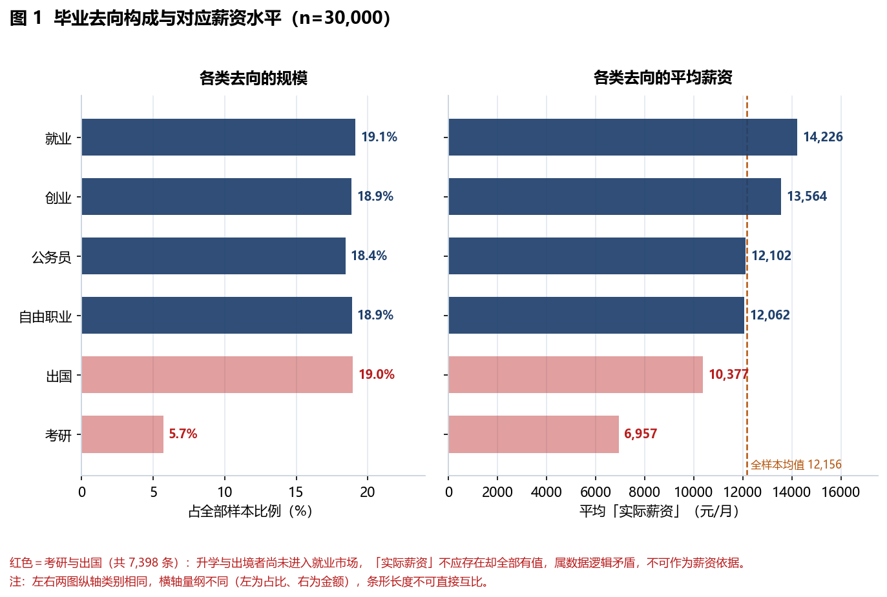
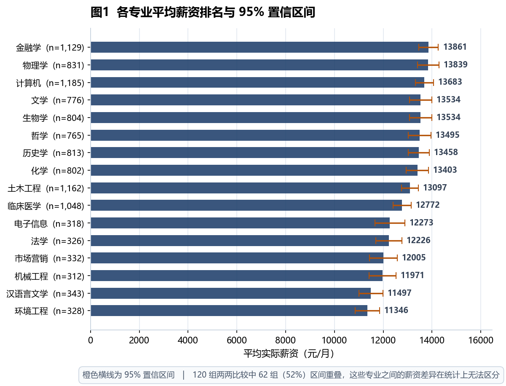
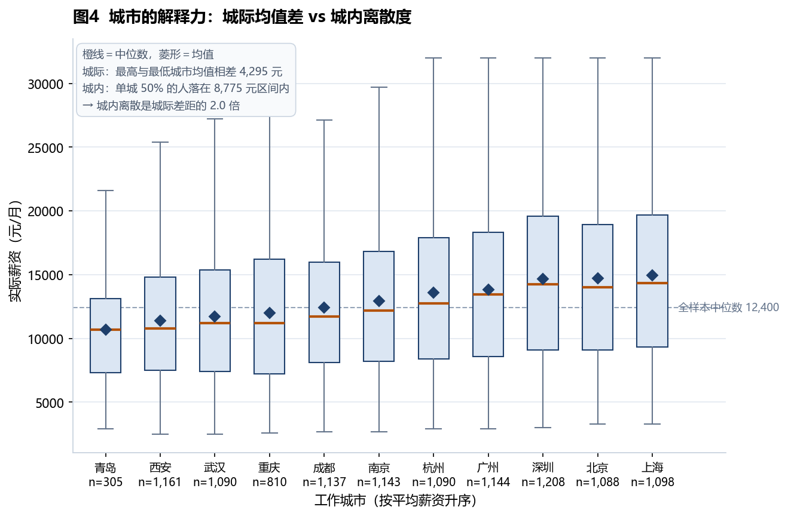

<div align="center">

# 高校毕业生就业数据统计分析

**30,000 条毕业生微观记录的清洗、探索与结论**

不是「画几张图」，而是回答一个能指导行动的问题


[📄 完整报告](report.md)　·　[🔍 核心结论](#核心结论)　·　[⚠️ 数据说明](#一个必须先说清的前提)　·　[⚙️ 复现方式](#复现方式)

</div>

---

## 项目简介

高校毕业生规模连年增长，就业问题已经从「能不能找到工作」变成「找到的工作值不值」。学生在毕业前要做的决策其实很集中：选什么行业、去哪座城市、要不要跨专业投递、实习值不值得花时间。这些决策的后果往往两三年后才显现，而做决定时手上几乎没有可比参照。

这个项目把一批毕业生微观记录整理成可分析的结构，先验证数据本身是否可信，再回答一个问题：

> **在学历、专业、行业、城市、匹配度、实习这六个变量里，哪些是毕业前根本改不了的，哪些还来得及？改了能值多少钱？**

|   编号   | 业务问题                      | 对应的决策                    |
| :----: | ------------------------- | ------------------------ |
|   Q1   | 六类去向的规模与回报差异有多大？          | 升学 / 考公 / 进企业 / 灵活就业怎么权衡 |
| **Q2** | **实际薪资与期望的落差有多大？谁最容易落空？** | 期望薪资该定多少                 |
|   Q3   | 学历、专业、行业、城市，哪个区分力最强？      | 投递时按什么顺序排优先级             |
| **Q4** | **哪些因素还改得动？改了值多少？**       | 剩下一年多时间该花在哪              |

---

## 核心结论

各变量对月薪的解释力排序（效应量 η²，就业口径 n=11,274）。η² 的含义是「该变量的分组能在多大程度上区分薪资」，**不是它对薪资的因果贡献**：

|  排序 | 变量    |    η² | 能否改变   | 结论              |
| :-: | ----- | ----: | ------ | --------------- |
|  1  | 岗位类型  | 6.49% | 部分可控   | 做什么岗位，区分力最强     |
|  2  | 学历    | 5.87% | 不可改    | 起门槛作用，不起定价作用    |
|  3  | 就业行业  | 5.77% | 可选     | 选赛道，与学历同量级      |
|  4  | 工作城市  | 4.36% | 可选     | 影响真实存在，但被高估     |
|  5  | 专业    | 1.20% | 不可改    | 一半以上专业对之间分不出高下  |
|  6  | 是否有实习 | 0.69% | **可控** | 单独看很弱，与匹配度叠加后很强 |

**① 专业的差距被高估了。** 16 个专业的均值跨度 2,515 元，看似层次分明；但 120 组两两比较中有 **62 组（52%）的置信区间相互重叠**——这些专业之间的差距，在统计上无法与随机波动区分。专业决定你能进哪些招聘池，不决定进去之后拿多少。

**② 学历是门票，不是价签。** 本科 11,238 元、硕士 13,330 元、博士 14,942 元，博士比本科高 33%。但三组箱体在 9,500–15,000 元区间大幅重叠，本科生薪资高于普通博士的情况完全存在。

**③ 期望落差存在清晰的学历梯度。** 本科 **49.5%** 的人没达到期望，硕士 16.0%，博士仅 1.6%。但三档学历的期望薪资均值只差 **186 元**——差异来自期望设定的高低，不是市场按学历定价。

**④ 城市的作用被高估了。** 城际均值极差 4,295 元，而单个城市内部中间 50% 的人横跨 8,775 元，**城内离散是城际差距的 2.0 倍**。知道一个人在深圳，几乎不能帮你判断他拿多少。

**⑤ 只有匹配度和实习是现在还能动的。** 专业-行业匹配度从低到高带来 2,777 元跨度，实习带来 1,035 元增量，两者不冲突且可叠加——**最优组合与最差组合相差 3,660 元（31.1%）**。这是全项目可操作性最强的一条。

---

## 一个必须先说清的前提

**这个项目用的数据经检验是程序生成的，不是真实调查数据。**

我在正式分析前做了 9 项真实性检验，证据构成完整链条：

| 检验        | 结果                                    |
| --------- | ------------------------------------- |
| 期望薪资 × 学历 | 三组均值仅差 186 元，η² = 0.000004（现实中不可能）    |
| 实际薪资取值    | 100% 落在整百档位，30,000 条只有 296 个不同值       |
| 期望薪资取值    | 33.5% 精确等于 500 的整数倍（纯随机应为 0.2%）       |
| 达成率字段     | 99.84% 精确等于 `round(实际 ÷ 期望, 3)`，无采集噪声 |
| 逻辑一致性     | 7,398 名考研 / 出国者全部被赋予「实际薪资」            |
| 专业-行业匹配度  | 94.2% 的组合取值唯一，是确定性查表生成                |

因此本项目的处理方式是：**方法与流程按真实项目标准完整执行，结论只停留在「方法层」与「结构层」，不把金额外推为现实市场水平。**

> 这不是项目的缺陷。**面试官在意的往往不是你用了什么数据，而是你会不会怀疑数据。** 一个能在分析前先问「这份数据能不能支撑我要下的结论」的人，比一个拿着数据直接画图的人可靠得多。

另有两条覆盖缺口，一并说明：

- **数据不含专科学历样本**（最低为本科）——对专科背景的分析者是硬伤，所以涉及专科群体的结论一律不下判断；
- **工作城市仅 11 个，全部为一线与新一线**——「回老家还是留大城市」这类问题，这份数据回答不了。

完整证据见 [report.md 第 3.1 节](report.md#31-数据质量初检9-项检验与结论)。

---

## 关键图表

**去向结构：六条路的规模与回报**

红色为考研与出国——这两类人尚未进入就业市场，「实际薪资」不应存在却全部有值。这张图同时是去向分布和数据矛盾的可视化。



**专业差异有多少是噪声**

每个点为专业均值，橙色横线为 95% 置信区间。120 组两两比较中 52% 的区间重叠，意味着这些专业的薪资差距无法与随机波动区分。



**城市：城际差异 vs 城内离散**

所有城市的箱体都横跨全样本中位数线。城际均值极差 4,295 元，而单城内中间 50% 的人横跨 8,775 元。



<details>

<summary><b>展开查看全部 8 张图表说明</b></summary>

|  图  | 文件                                    | 回答的问题           |
| :-: | ------------------------------------- | --------------- |
| 图 1 | `fig01-destination-and-salary.png`    | 六类去向的规模与回报      |
| 图 2 | `fig02-salary-distribution.png`       | 实际薪资与期望薪资的整体分布  |
| 图 3 | `fig03-expectation-gap.png`           | 达成率的学历梯度，谁最容易落空 |
| 图 4 | `fig04-education-and-salary.png`      | 学历溢价是否成立        |
| 图 5 | `fig05-major-confidence-interval.png` | 专业之间的差距是信号还是噪声  |
| 图 6 | `fig06-industry-city-heatmap.png`     | 行业 × 城市的薪资矩阵    |
| 图 7 | `fig07-city-dispersion.png`           | 城际差异 vs 城内离散    |
| 图 8 | `fig08-match-internship.png`          | 匹配度与实习的叠加效应     |

</details>

---

## 方法论：四个不寻常的处理

**1. 口径隔离，先于一切分析。** 全样本 30,000 条的平均薪资，与就业口径 11,274 条相差 1,028 元。所有涉及金额的结论都标注口径，图表与正文使用同一口径——这是最容易出错、也最容易被面试官抓到的地方。

**2. 用效应量 η² 代替 p 值。** 样本量上万时，p 值几乎必然显著，它只回答「有没有差异」；η² 回答「这个差异解释了多大比例的变异」，后者才是决策依据。环境没有 scipy，用组间方差 / 总方差实现，结论等价。

**3. 用置信区间重叠判断差异是否真实。** 52% 的专业对之间区间重叠，直接推翻了「专业排名决定薪资」的直觉。比给一堆 p 值更有说服力。

**4. 去重看业务含义，不看字段长相。** 岗位 ID 重复率 92.3%（30,000 条仅对应 2,313 个岗位），但这是「一个岗位录用多名毕业生」的 1:N 关系，不是脏数据。按常规去重会丢掉 92% 的样本，且剩下的是「岗位」而非「毕业生」，与项目主题直接冲突。

其余两个非标准判断（异常值只标记不删除、归一化结果另起新列保留原值）见 [report.md 第 3.3 节](report.md#33-三个非标准判断)。

---

## 仓库结构

```text
graduate-employment-analysis/
├── README.md                     ← 你在这里
├── report.md                     完整报告（6 章 + 附录，8 图 12 表）
├── figures/                      报告配图 8 张
├── src/
│   ├── audit_data.py             数据真实性审计（9 项检验）
│   ├── clean.py                  清洗流水线（7 步，逐步记录影响条数）
│   ├── eda.py                    探索分析（5 维度 + 统计表 + 8 图）
│   ├── viz.py                    可视化方案（4 张决策图）
│   └── report_figs_graduate.py   报告配图（去向结构与达成率梯度）
├── data/
│   ├── raw/                      原始数据（GB18030，17 字段）
│   └── clean/                    运行 clean.py 后生成（UTF-8-SIG，28 列）
└── outputs/
    ├── data_quality_report.csv   清洗 7 步各自的影响条数
    ├── field_dictionary.csv      字段字典
    ├── credibility_check.csv     9 项可信度检验结果
    └── EDA发现清单.md            分组统计与发现汇总
```

---

## 复现方式

```bash
git clone https://github.com/<your-name>/graduate-employment-analysis.git
cd graduate-employment-analysis
pip install pandas numpy matplotlib

python src/audit_data.py            # 1. 先验证数据，9 项检验
python src/clean.py                 # 2. 清洗，产出 28 列数据集 + 质量报告
python src/eda.py                   # 3. 探索分析，产出统计表与 8 张图
python src/viz.py                   # 4. 可视化方案，4 张决策图
python src/report_figs_graduate.py  # 5. 报告配图
```

依赖仅 `pandas` / `numpy` / `matplotlib`，**不需要 scipy**。五个脚本相互独立，可单独运行；更换数据源时只需修改 `clean.py` 顶部的字段映射字典。

> 原始数据为 **GB18030** 编码，直接按 UTF-8 读取会抛 `UnicodeDecodeError: byte 0xd0`。这是国内导出的表格最常见的问题，脚本中已用 `encoding='gb18030'` 处理。

---

## 局限与后续

**数据层面**：程序生成、无专科样本、城市仅 11 个、缺个体级薪酬明细（无法做岗位内部分层）。

**方法层面**：未做多因素回归（仅单变量 η²，存在混淆变量）、未做时间序列（数据无时间维度）、薪酬只能做相对比较不能输出绝对值。

**后续优化方向**：

| 优先级 | 事项                                 |
| :-: | ---------------------------------- |
|  P0 | 接入含专科样本的真实招聘数据，把「高职 vs 本科」对比单独做成一节 |
|  P0 | 用多元回归或分层模型替代单变量 η²，控制混淆变量          |
|  P1 | 解析高校《毕业生就业质量年度报告》PDF，做口径对齐后的跨校对比   |
|  P1 | 补充「岗位需求 / 毕业生供给」比值，给错配分析加需求侧证据     |
|  P2 | 交互式看板（行业 × 城市 × 学历多维筛选）            |

---

## 关于我

**谭茹方** — 四川财经职业学院 · 大数据技术专业（2027 届）

求职方向：数据采集 / 数据治理 / 数据分析（川渝地区）

这个项目是我从「拿数据画图」转向「先怀疑数据、再回答问题」的转折点。如果这份仓库里的某个判断让你觉得可以聊一聊，欢迎联系。

📧 `your-email@example.com`

---

<div align="center">
   <sub>本仓库数据经检验具有程序生成特征，报告中的金额与比例仅用于方法演示，不代表真实就业市场水平。</sub>
  
</div>
