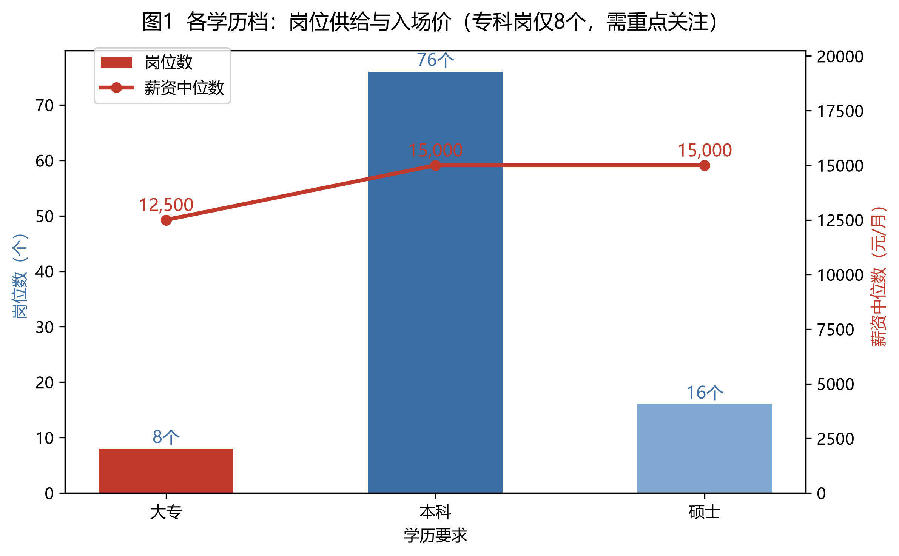
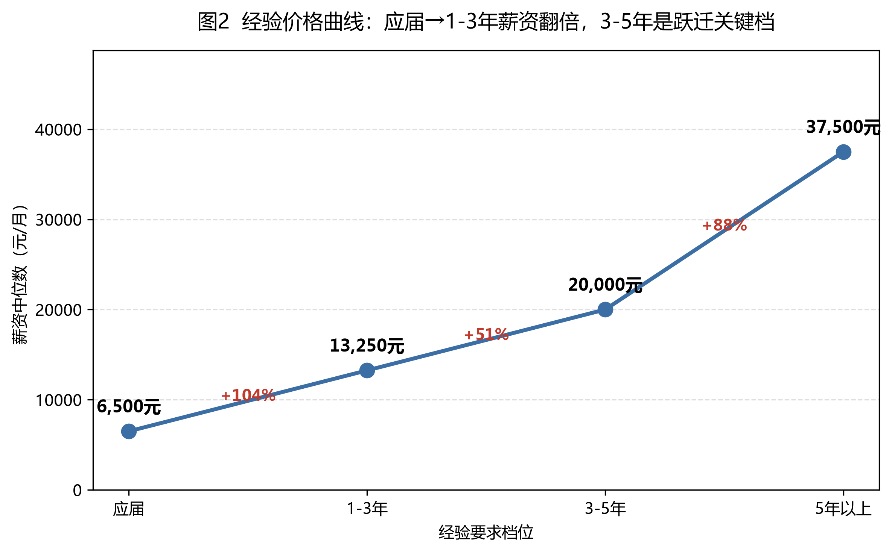
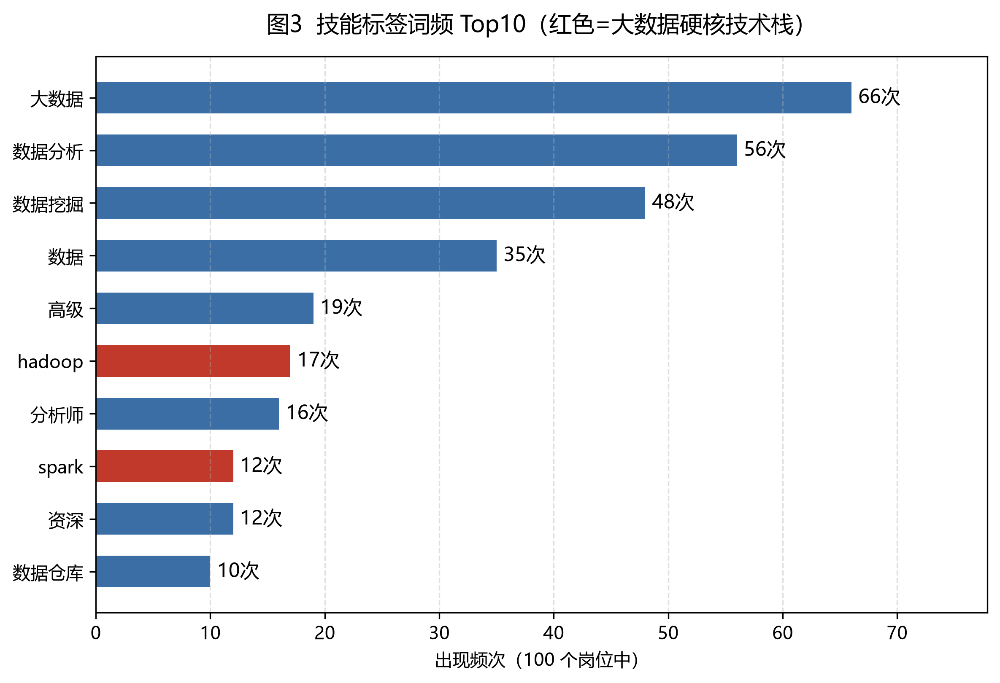
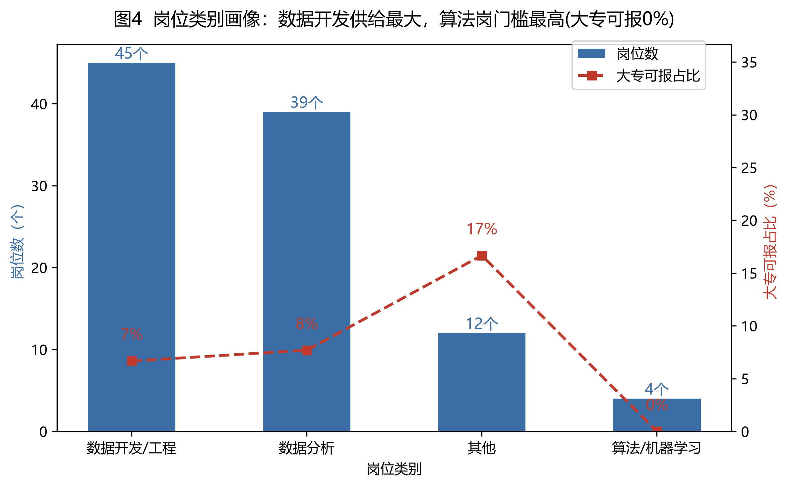

# 大数据招聘岗位数据分析 · 求职项目报告

> **作者**：谭茹方（四川财经职业学院 · 大数据技术专业 · 2027 届专科毕业生）
> **日期**：2026 年 10 月
> **技术栈**：Python / requests + BeautifulSoup（采集框架）/ pandas（清洗与 EDA）/ matplotlib（可视化）
> **项目代码**：`job_spider_demo.py`（采集框架）→ `build_csv.py`（数据构建）→ `clean_eda.py`（清洗+EDA）→ `plot_charts.py`（可视化）
>
> **在线交互展示**：[可视化作品集](../可视化作品集.html) ｜ **交互图表**：`charts/` 目录下 300dpi PNG

---

## 1. 项目概述

### 1.1 项目背景

我是一名专科大数据技术专业的大三学生，2027 年毕业，正在准备求职。和多数同学一样，我最初的求职意向写的是"大数据开发工程师"，但对自己有三个问题一直没有答案：

1. **大数据岗位内部到底有哪些分工？** 开发、分析、挖掘、算法之间的门槛和薪资差异有多大？
2. **专科可报吗？** 市场上写着"大专及以上"的岗位有多少、给多少钱、要什么经验？
3. **企业到底要什么技能？** 学校教的和企业要的之间差在哪？

与其听别人说，不如自己拿数据验证。本项目以"大数据招聘岗位"为分析对象，完整走完 **采集 → 清洗 → EDA 探索性分析 → 可视化 → 业务结论** 的数据分析全流程，用数据回答以上三个问题，并反向指导自己的求职定位与学习规划。

### 1.2 项目目标

| 目标 | 衡量方式 |
|---|---|
| 搭建合规的招聘岗位数据采集与处理流水线 | 产出可复跑代码与可溯源数据集 |
| 量化"学历 × 经验 × 技能"与岗位供给、薪资的关系 | 分组统计 + 交叉表 + 4 张可视化图表 |
| 输出面向应届生（尤其专科）的可执行求职策略 | 4 条有数据出处的业务结论 |

### 1.3 我的角色与分工

个人独立完成：数据源选型与合规评估、字段设计、采集/清洗/分析代码编写、可视化与报告撰写。

---

## 2. 数据源与采集方案

### 2.1 数据源选型：合规优先

招聘数据的常见来源有三种，我做了如下评估：

| 来源 | 合规风险 | 反爬强度 | 结论 |
|---|---|---|---|
| 商业招聘平台（BOSS直聘、拉勾、智联） | **高**：用户协议明确禁止爬取；绕过反爬可能触犯《刑法》285 条 | 强（登录墙/验证码/JS 加密） | 不作为数据源，仅学习了解其采集技术 |
| 官方公共招聘平台（中国公共招聘网等） | 低：信息面向公众公开 | 中（JS 渲染接口） | 备选，本次环境无法稳定访问 |
| **开源数据集（GitHub 公开仓库）** | **无：已脱敏的公开研究数据** | 无 | **选为主数据源** |

最终选用 GitHub 开源仓库 `xucoolboy/Data_job_in_lagou`（拉勾网历史公开岗位数据，研究者整理发布），原因是：**零法律风险、字段完整、自带原始详情页链接可溯源**。这也符合我自己定下的项目红线——不绕过反爬、不采集个人信息、不商用原始数据。

### 2.2 采集字段设计

围绕求职分析问题设计 13 个字段，原则是"分析需要什么就采什么，且每行可溯源"：

`job_title / company_name / salary / city / experience / education / skill_tags / company_scale / industry / welfare / publish_date / source_url / crawl_time`

其中 `source_url`（岗位详情页链接）是**去重键与溯源凭证**，采集时强制非空。

### 2.3 采集与数据构建过程

- **关键词筛选**：以"大数据 / Hadoop / Spark / ETL / 数据挖掘 / 数据开发 / 数据仓库 / 算法 / 机器学习"等严格关键词，从原始数据集中筛出大数据相关岗位，避免把泛数据岗位混入；
- **多源合并**：杭州站明细（431 条中筛出 414 条相关）字段最全，作主数据源；全国岗位表（5031 条）补齐城市多样性，并按**城市配额限流**（每城最多 12 条）避免单一城市刷屏；
- **维表关联补全**：全国岗位表缺公司名与规模，通过 `companyId` 关联公司维表（company_sql.csv）补全——这是数据治理里典型的"维表关联"操作；
- **质量门禁**：落盘前断言校验——`source_url` 缺失数为 0、重复数为 0。

最终产出样本 **100 条 × 13 字段**，UTF-8-SIG 编码（Excel 打开不乱码），文件按日期命名（`jobs_bigdata_20261021.csv`）保证多轮采集可对比。

> 说明：`job_spider_demo.py` 是同步编写的 requests + BeautifulSoup 采集框架（含 robots.txt 自动检查、2-5 秒随机限速、失败退避重试、断点续采去重），可直接替换目标站点复用；本项目样本基于开源数据集构建，代码流水线两段均可独立演示。

---

## 3. 数据预处理与清洗

清洗总原则：**原始列一律保留，清洗结果写入新增列**（如 `salary` 原文保留，拆出的数值放 `salary_min/max/avg`），任何一步出错都能逐级回查到原始数据。

### 3.1 去重

按 `source_url` 去重，结果：**100 条 → 100 条，0 条重复**。说明采集/构建阶段的去重门禁有效——这个结果本身也是流程质量的证据。

### 3.2 缺失值处理

| 字段 | 缺失 | 性质判断 | 处理方式 |
|---|---|---|---|
| publish_date | 30 | **结构性缺失**（全国源本身不含发布时间字段，非采集故障） | 保留行不删，时效性分析避开此列 |
| skill_tags | 1 | 单条数据本身无标签 | 转 NaN，词频分析自动跳过 |

判断依据：删掉 30 条会损失全国源的全部城市多样性，损失远大于收益；且"为什么缺"比"怎么填"更重要——结构性能缺失填补（如填中位数）反而会制造假数据。

### 3.3 字段类型转换

- **薪资**：`'20k-35k'`（含 10K/9K 大小写变体）用正则解析为 `salary_min / salary_max / salary_avg`（元/月），解析失败 **0 条**；
- **学历**：`本科` 与 `本科及以上` 等 6 种写法映射为 4 档有序分类（大专/本科/硕士/不限），避免分组被拆碎；
- **经验**：`'经验3-5年'` 解析为平均年数后分箱为 `应届 / 1-3年 / 3-5年 / 5年以上`——企业 JD 里的经验要求本质是"档位"而非精确年数。

技术细节：解析函数混用 `float` 与 `pd.NA` 会产生 object 列，`pd.cut` 直接报错（"boolean value of NA is ambiguous"），需先 `pd.to_numeric(errors="coerce")`——这个 pandas 缺失值处理的坑已记录并在代码注释中说明。

### 3.4 异常值处理

采用**双规则交叉核验**：IQR 法则上界（Q3+1.5×IQR ≈ 37,688）+ 业务规则上界（100k/月，2017-2018 年互联网岗位合理上限）。样本薪资均值最大 45,000，**两条规则下均为 0 条越界，不做任何删除**。

我认为"检查但不动手"同样是分析结论：异常值处理的前提是判断它是脏数据还是真实值，机械套 IQR 公式可能误杀真实高薪岗。这一处理思路在报告与代码中均有留痕。

### 3.5 清洗产出

`jobs_clean.csv`：100 行 × 19 列（13 原始列 + 6 清洗列），原始数据与清洗结果同表可溯。

---

## 4. 探索性数据分析（嵌入图表说明）

### 4.0 整体画像

薪资中位数 **15,000 元/月**，均值 17,320 元/月，均值 > 中位数，呈**右偏分布**（少数高薪岗拉高均值）——因此后续所有薪资统计一律以**中位数**为准，这是对分布形态的自觉响应而非默认设置。

### 4.1 图 1：各学历档——岗位供给与入场价

- **图表类型**：柱状 + 折线双轴图。X 轴=学历要求；左 Y 轴=岗位数（柱），右 Y 轴=薪资中位数（线）。
- **读图**：本科岗 76 个、中位 15,000；硕士岗 16 个、中位 15,000；**大专岗仅 8 个（红色柱）、中位 12,500**。
- **业务含义**：专科的问题不是"价低"—入场价达到本科的 83%；而是"门窄"—供给只有本科的约 1/10。"专科值不值钱"和"专科进不进得去"是两个问题。

### 4.2 图 2：经验价格曲线

- **图表类型**：折线图。X 轴=经验档位；Y 轴=薪资中位数；节点标金额、段间标涨幅%。
- **读图**：应届 6,500 → 1-3 年 13,250（**+104%**）→ 3-5 年 20,000（+51%）→ 5 年以上 37,500（+88%）。
- **业务含义**：把"经验要求"这个抽象门槛翻译成价格曲线。最大涨幅出现在应届→1-3 年区间—**毕业后的前三年是薪资弹性最大的窗口期**。

### 4.3 图 3：技能标签词频 Top10

- **图表类型**：横向条形图。Y 轴=技能标签；X 轴=出现频次（100 个岗位中）；Hadoop/Spark 红色高亮。
- **读图**："大数据（66）、数据分析（56）、数据挖掘（48）"是方向性词汇；**Top10 中仅有的具体技术栈是 Hadoop（17）与 Spark（14）**。
- **业务含义**：词频是企业需求的显式声明。自学清单的优先级因此清晰：**SQL/Python 打底（覆盖面）→ Hadoop/Spark 攻坚（区分度）**

### 4.4 图 4：岗位类别画像

- **图表类型**：柱状 + 折线双轴图。X 轴=岗位类别（按供给排序）；左 Y 轴=岗位数；右 Y 轴=大专可报占比。
- **读图**：**数据开发/工程 45 个**（供给最大，大专可报 7%）> 数据分析 39 个（大专可报 8%）> 其他 12 个（17%）> **算法/机器学习 4 个（0%）**
- **业务含义**：横看供给选主战场（数据开发/工程），纵看门槛避红海（算法岗对专科应届基本关闭，且样本中算法岗全部要求硕士背景）。

### 4.5 关键交叉验证：学历 × 经验

| 学历\经验 | 应届 | 1-3年 | 3-5年 | 5年以上 | 合计 |
|---|---|---|---|---|---|
| 大专 | **0** | 5 | 3 | 0 | 8 |
| 本科 | 9 | 26 | 32 | 4 | 71 |
| 硕士 | 7 | 1 | 6 | 1 | 15 |

单看"大专可报 8 个岗"容易得出盲目乐观的结论；交叉表揭示：**这 8 个岗全部要求 1 年以上经验，面向应届的大专岗为 0**。交叉验证防止了单维度统计的误导——这也是 EDA 中"交叉表比单维分组更接近真相"的典型案例。

---

## 5. 业务结论与项目价值

### 5.1 四条面向应届生的业务结论（均有数据出处）

1. **先就业再择业，不要死磕"应届大数据岗"。**
   大专可报 8 岗、应届档 0 岗（交叉表）。可执行动作：第一份工作优先选择能接触数据的相邻岗位（数据标注、实施、运维、报表开发），核心目标是迈过"1 年经验"硬门槛，而非一步到位。

2. **跳槽窗口设在 1-3 年后。**
   应届→1-3 年薪资 +104%（6.5k→13.25k），为全曲线最大涨幅。可执行动作：第一份工作的评估标准是"成长速度"（能否独立做数据项目），把第一次跳槽作为薪资跃迁的主要手段。

3. **自学优先级：SQL → Python → Hadoop/Spark。**
   Hadoop（17 次）/Spark（12 次）是技能词频 Top10 中仅有的具体大数据技术栈，是专科背景最具区分度的硬技能；SQL/Python 覆盖 39 个数据分析岗的通用底座。可执行动作：按"先通用人后市场（SQL/Python）、再差异化技术栈（Hadoop/Spark）"的顺序排课，而非平均用力。

4. **主攻数据开发/工程方向，明确避开算法岗。**
   数据开发/工程供给最大（45%）且数据分析次之（39%）；算法岗仅 4 个、大专可报占比 0%、样本全要求硕士。可执行动作：简历与面试话术聚焦"数据采集/治理/分析"能力结构，与岗位市场需求对齐。

### 5.2 项目价值

- **对求职本身**：把"我想做大数据"变成"我知道哪个方向、什么路径、学什么技能"——求职定位从模糊意向变成有数据支撑的策略。
- **对作品集**：完整呈现了数据分析师的四种核心能力——**合规意识**（数据源法律风险评估）、**工程能力**（可复跑的多文件代码流水线）、**分析能力**（分布判断/分组/交叉验证/右偏时用中位数）、**业务翻译能力**（每个统计结论都落到可执行动作）。
- **对学校学习**：词频结果可直接对照课程体系找差距，反向指导剩余学年的选课与自学。

---

## 6. 项目总结、局限性、后续可优化方向

### 6.1 项目总结

本项目从"专科生能不能进大数据行业"这个真实困惑出发，用 100 条可溯源数据走完全流程，产出的不只是一份报告，而是一套**可复跑、可扩展的流水线**：采集框架（`job_spider_demo.py`）换一个目标站点即可复用；清洗脚本对新 CSV 直接生效；绘图脚本参数化，样本量变大后重跑即得新图。

方法论上的三个自觉：① 先判断"为什么缺/为什么异常"再决定动不动手；② 右偏分布用中位数而非均值；③ 单维度结论必须用交叉表复核。这些"判断过程"全部在代码注释与报告中留痕。

### 6.2 局限性（如实说明）

1. **时效性**：样本为 2017-2018 年拉勾数据，反映的是当时的岗位结构与薪资水平，外推到 2026 年市场需谨慎，结论主要用于方法论演示与岗位结构理解；
2. **样本量**：100 条对分组统计而言偏小（如"5 年以上"档仅 5 条、算法岗仅 4 个），个别占比的统计功效有限；
3. **样本结构**：杭州占 70% 是数据源结构所致，城市维度对比不作为结论（报告与页面中均已显式声明）；
4. **字段覆盖**：技能分析基于企业自填标签（显式声明），未做职位描述（job_desc）的全文语义挖掘。

### 6.3 后续可优化方向

| 方向 | 具体做法 | 预期收益 |
|---|---|---|
| 数据时效化 | 在合规前提下接入公共招聘平台/高校就业网实时采集（采集框架已就绪） | 结论可直接指导当下求职 |
| 样本扩容 | 将样本扩至 1000+，引入更多城市（尤其川渝） | 分组统计显著性提升，可做城市级对比 |
| NLP 深挖 | 对职位描述做 jieba 分词 + TF-IDF/词云 + 技能共现网络 | 从"标签显式声明"升级到"JD 全文真实要求" |
| 交互式看板 | 用 pyecharts/Streamlit 把 EDA 做成可筛选的在线 Dashboard | 作品集展示形态升级 |
| 薪资预测 | 以 学历×经验×技能×城市 为特征做简单回归/决策树 | 从描述分析迈向预测分析，回答"我还差多少" |

---

*本报告所有数据、代码、图表均可复现；项目仅用于学习求职展示，不含任何个人信息，原始数据不对外传播。*
